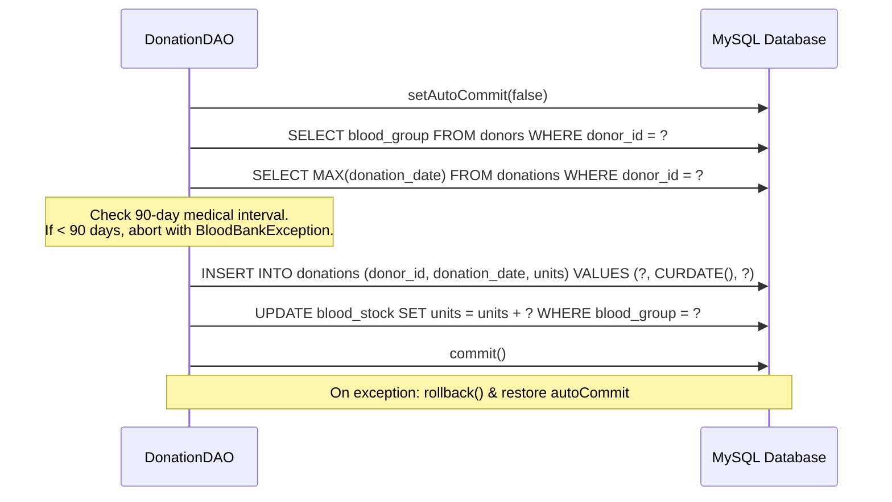
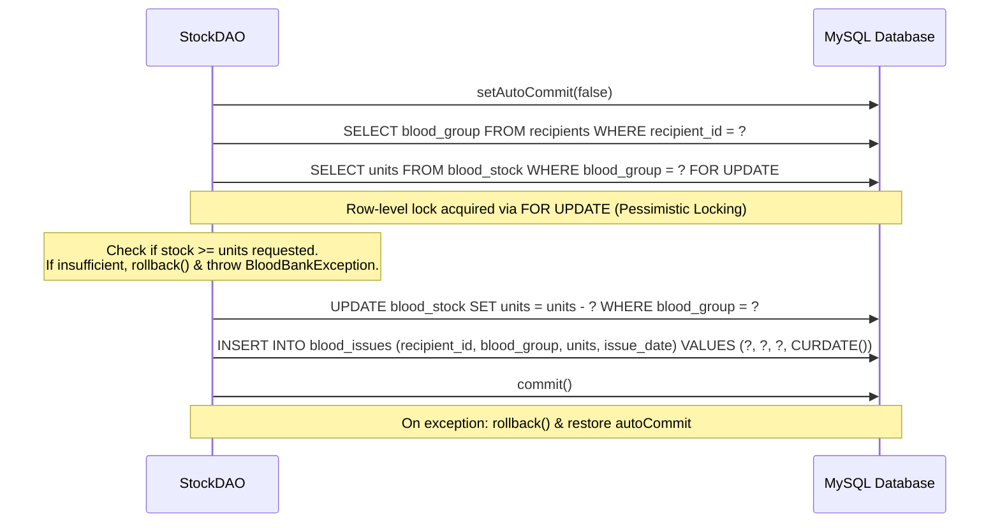

# BloodBank Database Architecture & DBMS Technical Notes
**Author**: Member 2 (Database Layer Lead)  
**System**: Blood Bank Donation Management System (Terminal Application)  
**Tech Stack**: Java 17 | JDBC | MySQL 8.0 (InnoDB, UTF-8)

---

## 1. Relational Schema & Table Specifications

The schema comprises 6 normalized tables ensuring referential integrity, domain integrity, and enterprise auditability.

### Table 1: `blood_groups` (Reference / Lookup)
- **Purpose**: Canonical master lookup for valid ABO and Rh blood types.
- **Primary Key**: `blood_group VARCHAR(3)` (e.g., `'A+'`, `'O-'`).
- **Foreign Keys**: None.
- **Constraints**: Enforces controlled vocabulary across donors, recipients, inventory, and disbursements.
- **Seed Data**: 8 rows (`'A+'`, `'A-'`, `'B+'`, `'B-'`, `'O+'`, `'O-'`, `'AB+'`, `'AB-'`).

### Table 2: `donors` (Entity)
- **Purpose**: Stores verified donor personal and medical qualification details.
- **Primary Key**: `donor_id INT AUTO_INCREMENT`.
- **Foreign Keys**: `blood_group` $\rightarrow$ `blood_groups(blood_group)` (`ON UPDATE CASCADE ON DELETE RESTRICT`).
- **Constraints**:
  - `age`: `CHECK (age BETWEEN 18 AND 65)` (statutory blood donation age bracket).
  - `phone`: `VARCHAR(15) UNIQUE NOT NULL` (guarantees one donor identity per phone number).
  - `registered_on`: `DATE NOT NULL DEFAULT (CURRENT_DATE)`.
- **Index**: `idx_donors_blood_group` on `(blood_group)` to optimize filtering by blood type.

### Table 3: `recipients` (Entity)
- **Purpose**: Stores recipient/patient details needing transfusions.
- **Primary Key**: `recipient_id INT AUTO_INCREMENT`.
- **Foreign Keys**: `blood_group` $\rightarrow$ `blood_groups(blood_group)` (`ON UPDATE CASCADE ON DELETE RESTRICT`).
- **Constraints**:
  - `age`: `CHECK (age BETWEEN 0 AND 120)` (valid human lifespan).
  - `phone`: `VARCHAR(15) UNIQUE NOT NULL`.
  - `hospital`: `VARCHAR(80) NOT NULL` (institutional tracking for audit compliance).

### Table 4: `donations` (Transaction)
- **Purpose**: Logs individual blood donation events by registered donors.
- **Primary Key**: `donation_id INT AUTO_INCREMENT`.
- **Foreign Keys**: `donor_id` $\rightarrow$ `donors(donor_id)` (`ON DELETE CASCADE ON UPDATE CASCADE`).
- **Constraints**:
  - `units`: `CHECK (units > 0)`.
  - `donation_date`: `DATE NOT NULL`.
- **Index**: `idx_donations_donor_id` on `(donor_id)` for high-speed foreign key joins and interval history checks.

### Table 5: `blood_stock` (Inventory State)
- **Purpose**: Maintains active available units per blood type.
- **Primary Key**: `blood_group VARCHAR(3)`.
- **Foreign Keys**: `blood_group` $\rightarrow$ `blood_groups(blood_group)` (`ON UPDATE CASCADE ON DELETE RESTRICT`).
- **Constraints**:
  - `units`: `CHECK (units >= 0)` (database-level guard preventing negative inventory).
- **Seed Data**: 8 rows initialized to 0 units.

### Table 6: `blood_issues` (Disbursement / Transaction)
- **Purpose**: Records blood units issued from inventory to recipients.
- **Primary Key**: `issue_id INT AUTO_INCREMENT`.
- **Foreign Keys**:
  - `recipient_id` $\rightarrow$ `recipients(recipient_id)` (`ON DELETE CASCADE ON UPDATE CASCADE`).
  - `blood_group` $\rightarrow$ `blood_groups(blood_group)`.
- **Constraints**:
  - `units`: `CHECK (units > 0)`.
  - `issue_date`: `DATE NOT NULL`.

---

## 2. Relationships & Referential Integrity

1. **`blood_groups` $\rightarrow$ `donors`, `recipients`, `blood_stock`, `blood_issues` ($1:M$ and $1:1$)**:
   - `ON DELETE RESTRICT`: Prevents accidental deletion of a blood group that is referenced by any record.
   - `ON UPDATE CASCADE`: Ensures that if a standard naming convention were updated, child records automatically follow.
2. **`donors` $\rightarrow$ `donations` ($1:M$)**:
   - One donor can have multiple historical donations over time.
   - `ON DELETE CASCADE`: Deleting a donor removes their historical donation entries, preventing orphan donation rows while maintaining clean referential integrity.
3. **`recipients` $\rightarrow$ `blood_issues` ($1:M$)**:
   - One recipient can receive blood multiple times across treatments.
   - `ON DELETE CASCADE`: Deleting a recipient cleans up related issue records.

---

## 3. Normalization (Proof of Third Normal Form - 3NF)

The schema strictly adheres to **Third Normal Form (3NF)**:

### First Normal Form (1NF)
- **Atomic Values**: Every column contains scalar, indivisible values (e.g. `name`, `phone`, `units`). There are no repeating groups, comma-separated lists, or arrays.
- **Defined Primary Keys**: Every table has a clearly defined unique primary key (`donor_id`, `recipient_id`, `donation_id`, `issue_id`, `blood_group`).

### Second Normal Form (2NF)
- The database is in 1NF.
- **No Partial Dependencies**: In tables with single-column primary keys (`donor_id`, `recipient_id`, `donation_id`, `issue_id`, `blood_group`), all non-key attributes depend on the entire primary key. There are no composite primary keys where an attribute depends only on a subset of the key.

### Third Normal Form (3NF)
- The database is in 2NF.
- **No Transitive Dependencies**: Non-key attributes depend directly and *only* on the primary key, with no indirect dependencies ($X \rightarrow Y \rightarrow Z$):
  - In `donors`, `name`, `age`, `blood_group`, and `phone` depend only on `donor_id`.
  - In `recipients`, `hospital` is an attribute of the recipient's admission, not determining blood type or phone.
  - In `donations`, donation details depend solely on `donation_id`.
  - Historical summary data (such as total units donated or last donation date) is **not** redundantly stored as columns in the `donors` table; instead, it is computed dynamically via SQL aggregate queries or the `donor_donation_summary` view. This completely eliminates update anomalies.

---

## 4. SQL Queries & Mechanics

### 1. Multi-Table Inner Join (`donors JOIN donations`)
Used in `DonorDAO.getDonationHistory()` to generate an audit report of all donation events:
```sql
SELECT d.donor_id, d.name, d.blood_group, d.phone, 
       dn.donation_id, dn.donation_date, dn.units
FROM donors d
JOIN donations dn ON d.donor_id = dn.donor_id
ORDER BY dn.donation_date DESC, dn.donation_id DESC;
```
*Why*: Directly matches parent donors with donation records. If a donor has not yet donated, they do not appear in this specific transaction audit report.

### 2. Relational View with `LEFT JOIN` and `GROUP BY`
Used in `donor_donation_summary` (read by `DonorDAO.getDonorSummary()`):
```sql
CREATE OR REPLACE VIEW donor_donation_summary AS
SELECT 
    d.donor_id,
    d.name,
    d.blood_group,
    COUNT(dn.donation_id) AS total_donations,
    COALESCE(SUM(dn.units), 0) AS total_units,
    MAX(dn.donation_date) AS last_donation
FROM donors d
LEFT JOIN donations dn ON d.donor_id = dn.donor_id
GROUP BY d.donor_id, d.name, d.blood_group;
```
*Why*: `LEFT JOIN` guarantees that every donor appears in the summary—even new donors with zero donations. `COALESCE(SUM(...), 0)` prevents null values for new donors.

### 3. Aggregation with `GROUP BY` (`StockDAO.getDonationSummaryByGroup()`)
```sql
SELECT d.blood_group, 
       COUNT(dn.donation_id) AS total_donations, 
       COALESCE(SUM(dn.units), 0) AS total_units
FROM donors d
JOIN donations dn ON d.donor_id = dn.donor_id
GROUP BY d.blood_group
ORDER BY d.blood_group;
```
*Why*: Allows the blood bank director to see collection metrics grouped by blood type.

### 4. Subquery / Aggregate Join (`DonorDAO.getAll()`)
```sql
SELECT d.donor_id, d.name, d.age, d.blood_group, d.phone, 
       MAX(dn.donation_date) AS last_donation
FROM donors d
LEFT JOIN donations dn ON d.donor_id = dn.donor_id
GROUP BY d.donor_id, d.name, d.age, d.blood_group, d.phone
ORDER BY d.name;
```
*Why*: Retrieves full donor entity models while simultaneously computing their latest donation date without requiring separate N+1 queries.

---

## 5. JDBC Transactions & ACID Guarantees

In financial and medical applications, atomic multi-step changes must never be partially applied. All critical modifications are guarded inside JDBC transactions (`setAutoCommit(false)` with explicit `commit()` and `rollback()`).

### Transaction 1: `DonationDAO.recordDonation(donorId, units)`


- **Atomicity**: The new donation entry in `donations` and the increment of inventory in `blood_stock` must occur together. If the server fails after inserting the donation, the stock update won't be lost; both succeed or both roll back.
- **Consistency**: The `CHECK (units > 0)` and foreign key to `donors` prevent corrupt records. The 90-day eligibility rule protects donor health.
- **Isolation**: Changes are uncommitted and invisible to other concurrent connections until `commit()`.
- **Durability**: Upon `commit()`, MySQL InnoDB writes transaction logs to disk (redo log / WAL).

### Transaction 2: `StockDAO.issueBlood(recipientId, units)`


- **Pessimistic Locking (`FOR UPDATE`)**: Prevents race conditions and double-allocation (overselling units) when concurrent requests arrive.
- **Rollback Guarantee**: If stock is insufficient, the transaction immediately rolls back, ensuring stock is never negative and `blood_issues` has no bogus rows.

---

## 6. How to Demonstrate This to the Evaluator

Follow these exact steps during your practical evaluation:

### Step 1: Show Database Connection and Schema
1. Open MySQL Shell or MySQL Workbench:
   ```sql
   USE bloodbank;
   SHOW TABLES;
   ```
   *Expected Output*: 6 base tables (`blood_groups`, `blood_stock`, `donations`, `donors`, `recipients`, `blood_issues`) and 1 view (`donor_donation_summary`).
2. Show table definitions and foreign keys:
   ```sql
   DESCRIBE donors;
   DESCRIBE blood_stock;
   SHOW CREATE TABLE donations\G
   ```
   *Point out*: Primary keys, `CHECK` constraints (`age BETWEEN 18 AND 65`, `units > 0`), and `ON DELETE CASCADE`.

### Step 2: Show Seed Reference Data (Zero Dummy Data)
```sql
SELECT * FROM blood_groups;
SELECT * FROM blood_stock;
```
*Point out*: Clean reference data. Exactly the 8 blood groups and 0 units initial inventory. No hard-coded dummy donors or recipients.

### Step 3: Run the Java Smoke Test
In the terminal, run:
```bash
# Windows
javac -cp "lib/*" -d out src/bloodbank/*/*.java
java -cp "out;lib/*" bloodbank.test.DaoSmokeTest

# Linux / macOS
javac -cp "lib/*" -d out src/bloodbank/*/*.java
java -cp "out:lib/*" bloodbank.test.DaoSmokeTest
```
*Point out*:
- Database connectivity via `db.properties` / fallback environment variables.
- CRUD lifecycle (Insert $\rightarrow$ Read $\rightarrow$ Update $\rightarrow$ Search $\rightarrow$ Delete).
- Method overloading demonstration (`search(bloodGroup)` vs `search(name, bloodGroup)`).
- 90-day donation interval restriction rejection.
- Over-issue stock rejection and rollback demonstration.
- Execution of JOIN, VIEW, and GROUP BY reports.
- Complete teardown leaving zero test artifacts.

### Step 4: Inspect View & Index Performance in MySQL
```sql
SELECT * FROM donor_donation_summary;
SHOW INDEX FROM donors;
SHOW INDEX FROM donations;
```

---

## 7. Integration Notes for Member 3 (UI / CLI Layer)

Member 3 can instantiate and call all DAO methods directly using standard Java objects:

### 1. `DonorDAO` (implements `Manageable<Donor>`)
```java
public void add(Donor donor) throws BloodBankException;
public List<Donor> getAll() throws BloodBankException;
public void update(Donor donor) throws BloodBankException;
public boolean delete(int donorId) throws BloodBankException;

// Overloaded search methods (Compile-Time Polymorphism)
public List<Donor> search(String bloodGroup) throws BloodBankException;
public List<Donor> search(String name, String bloodGroup) throws BloodBankException;

// Reports
public List<String> getDonationHistory() throws BloodBankException;
public List<String> getDonorSummary() throws BloodBankException;
```

### 2. `RecipientDAO` (implements `Manageable<Recipient>`)
```java
public void add(Recipient recipient) throws BloodBankException;
public List<Recipient> getAll() throws BloodBankException;
public void update(Recipient recipient) throws BloodBankException;
public boolean delete(int recipientId) throws BloodBankException;
```

### 3. `DonationDAO`
```java
// Executes transactional donation recording with 90-day check and stock increment
public int recordDonation(int donorId, int units) throws BloodBankException;

public List<Donation> getAll() throws BloodBankException;
public List<Donation> getByDonor(int donorId) throws BloodBankException;
```

### 4. `StockDAO`
```java
// Returns LinkedHashMap ordered by blood group (A+, A-, B+, B-, O+, O-, AB+, AB-)
public Map<String, Integer> getStock() throws BloodBankException;
public int getTotalUnits() throws BloodBankException;

// Executes transactional blood issuance with pessimistic locking and stock decrement
public int issueBlood(int recipientId, int units) throws BloodBankException;

// Analytical Reports
public List<String> getIssueHistory() throws BloodBankException;
public List<String> getDonationSummaryByGroup() throws BloodBankException;
```
