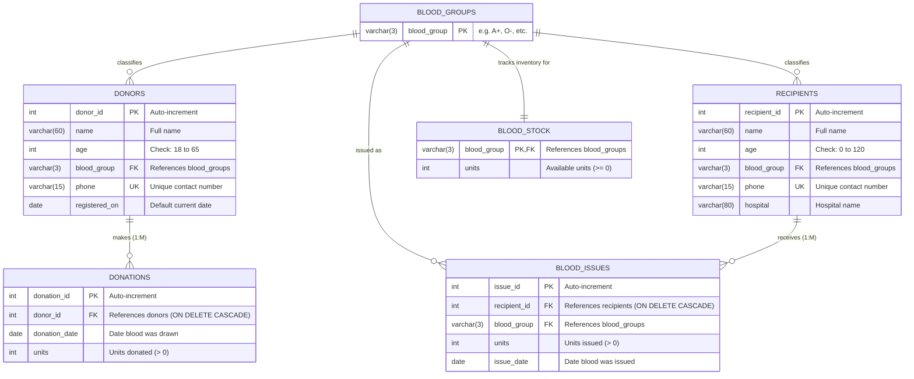

# BloodBank Database Entity-Relationship (ER) Diagram

The following diagram models the complete relational schema of the BloodBank donation and stock management system.

### Cardinality Summary
- **blood_groups (1) to donors (M)**: One blood group can be shared by zero or many donors. Each donor belongs to exactly one blood group.
- **blood_groups (1) to recipients (M)**: One blood group can be shared by zero or many recipients. Each recipient belongs to exactly one blood group.
- **blood_groups (1) to blood_stock (1)**: Exactly one stock entry per blood group.
- **donors (1) to donations (M)**: One donor can donate blood multiple times (1:M). `ON DELETE CASCADE` ensures donations are removed if donor record is deleted.
- **recipients (1) to blood_issues (M)**: One recipient can receive blood multiple times (1:M). `ON DELETE CASCADE` preserves referential integrity.
- **blood_groups (1) to blood_issues (M)**: Each issue transaction references the specific blood group disbursed.
